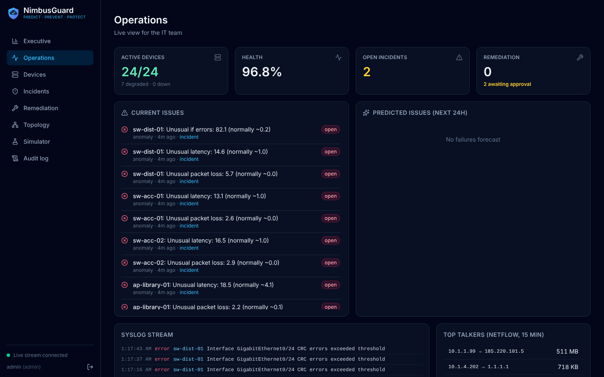
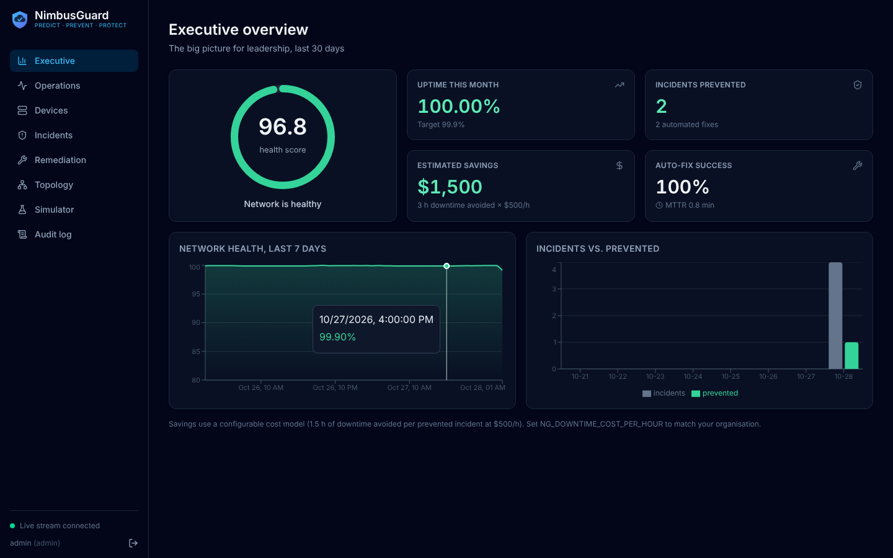
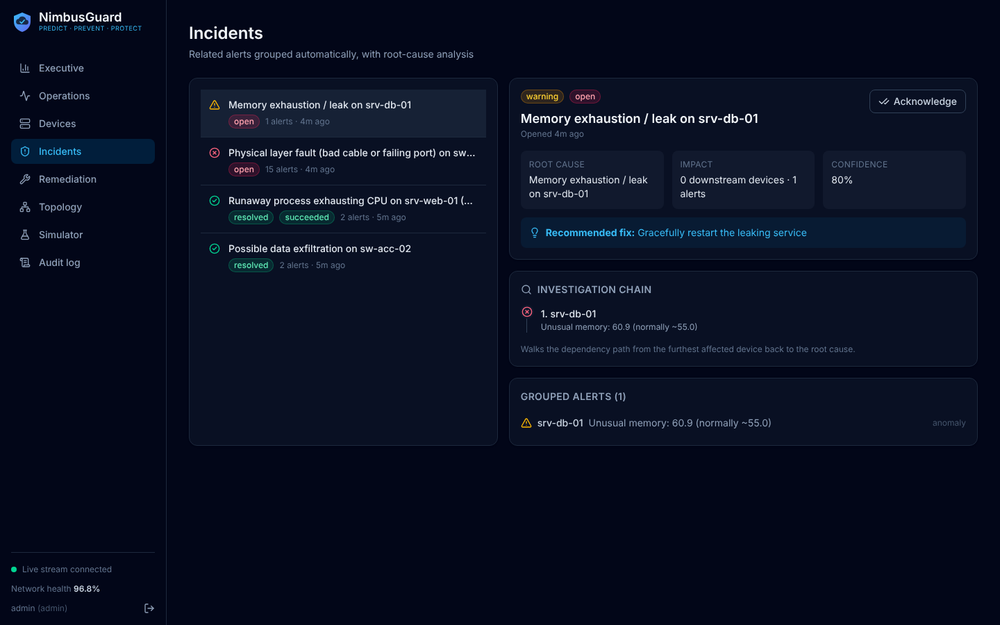
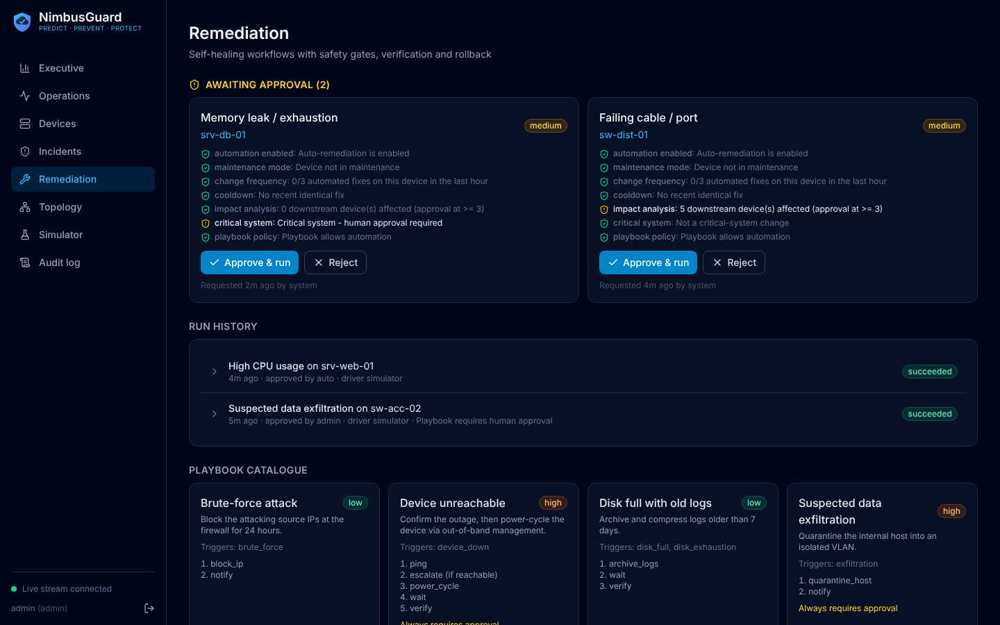
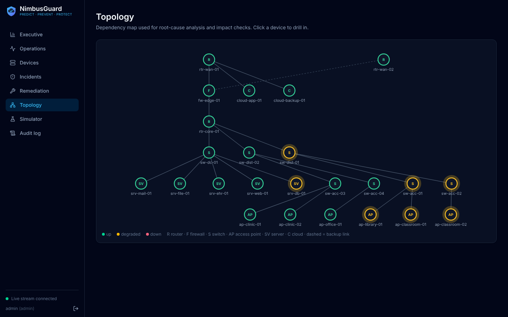
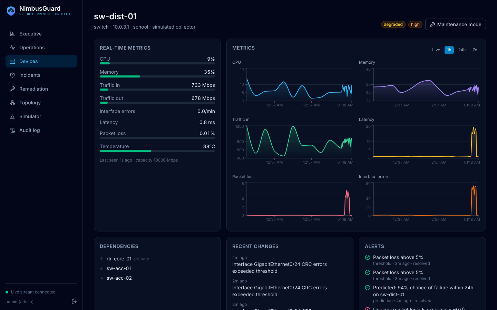
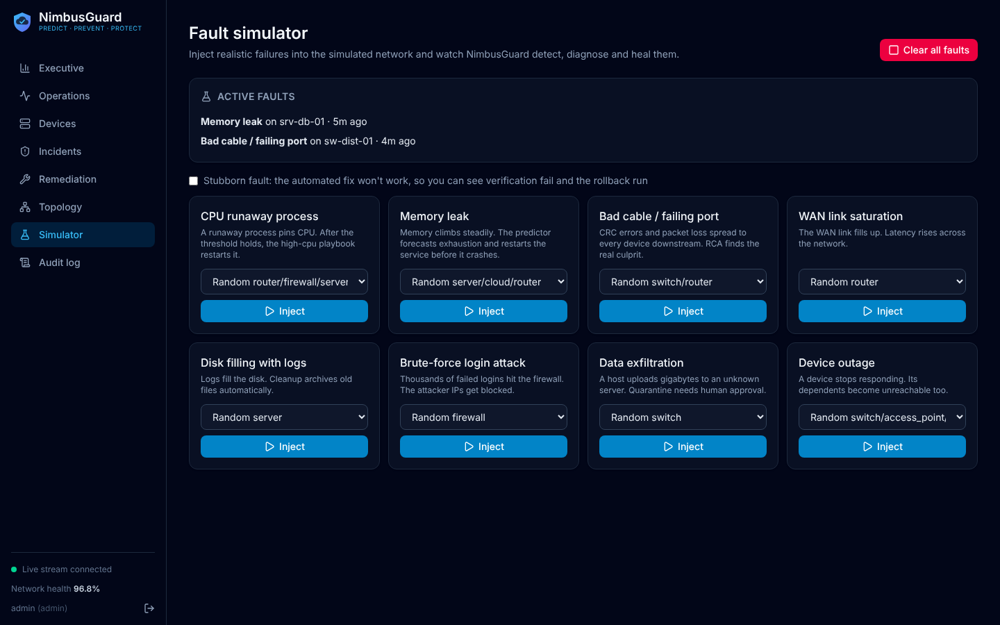
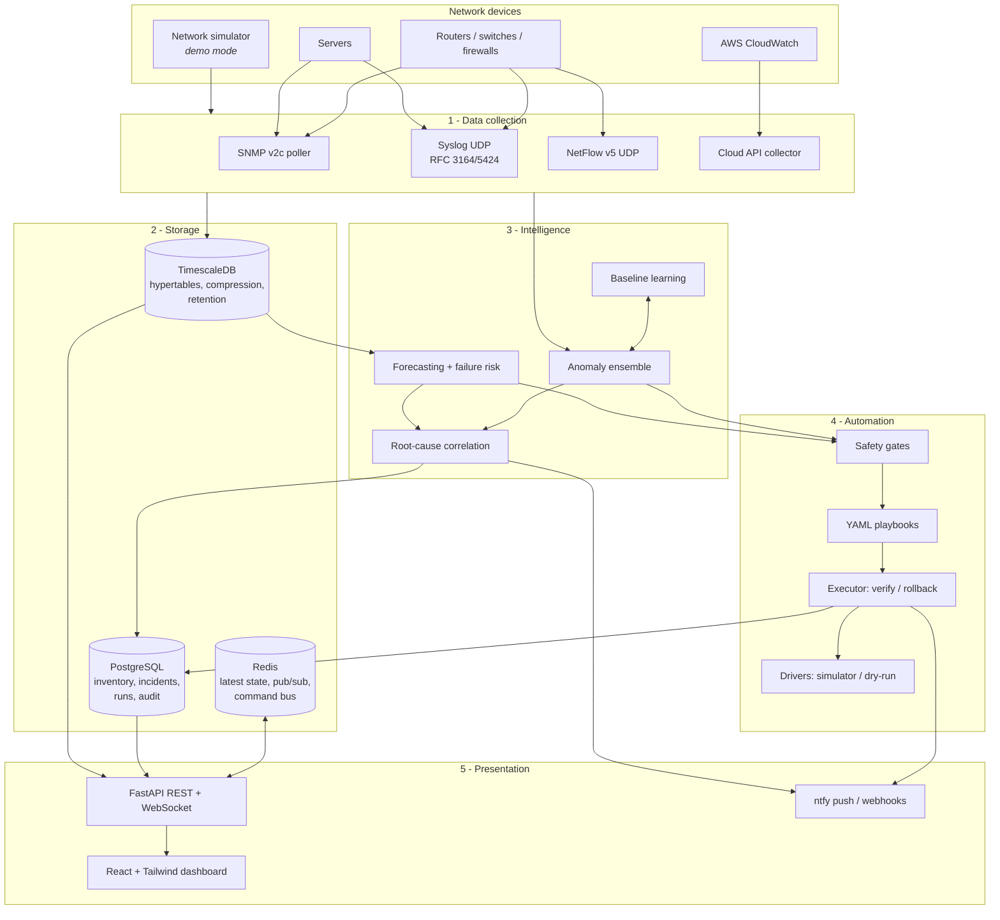
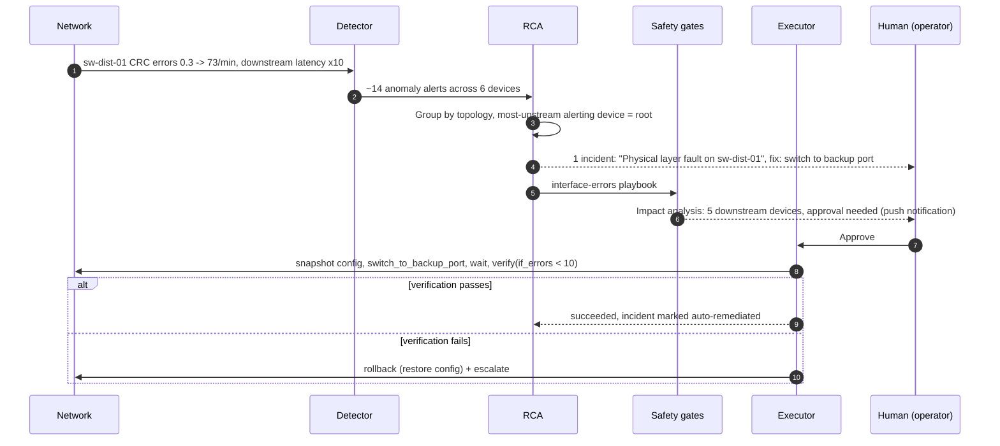

<div align="center">


# NimbusGuard

**Predict. Prevent. Protect.**

An AI-powered, self-healing network platform for organisations that can't afford an IT team watching dashboards at 3 AM: NGOs, schools and clinics.

[](https://github.com/MansiGondil/nimbusguard/actions/workflows/ci.yml)




</div>

---

NimbusGuard continuously collects network telemetry (SNMP, NetFlow, Syslog, cloud APIs) and **learns what "normal" looks like for every device at every hour of the week**. It **detects anomalies and forecasts failures** before they happen, then **traces symptoms back to the root cause** across the network topology. Finally it **repairs common problems automatically**, behind safety gates, with verification, rollback, human approval for risky changes and a tamper-evident audit trail.

It ships with a **realistic network simulator**, so the whole loop (detect, diagnose, heal) can be demoed on a laptop with one command, without any network hardware.

## Highlights

| | |
|---|---|
| 🧠 **Behavioural baselines** | Per-device, per-metric, hour-of-week statistics (Welford), with hour-of-day/global fallback while the system is still learning |
| 🚨 **Ensemble anomaly detection** | Seasonal z-scores + duration-held safety thresholds + Isolation Forest over z-score vectors. **95% recall / 98.5% precision** on labelled faults ([measured, not claimed](#detection-accuracy)) |
| 🔮 **Predictive analytics** | Multi-window trend forecasting ("memory exhaustion in ~25 min"), bandwidth saturation, and a logistic failure-risk model |
| 🔎 **Root-cause analysis** | Topology-aware alert correlation: the dozen-plus alerts caused by one bad cable become **one incident**, with an investigation chain and a recommended fix |
| 🩹 **Self-healing playbooks** | Declarative YAML workflows with conditional steps, post-fix verification and automatic rollback |
| 🛡️ **Safety gates** | Change-frequency limit (3/device/hour), cooldown, maintenance windows for high-risk changes, blast-radius impact analysis, critical-system and policy approval gates |
| 📜 **Auditable by design** | SHA-256 hash-chained audit log with one-click integrity verification; RBAC (viewer / operator / admin); credentials encrypted at rest (Fernet) |
| 📊 **Two audiences** | An executive view (health score, uptime, incidents prevented, $ saved) and an operations view (live metrics, issues, forecasts, syslog, top talkers) |
| 📱 **Mobile push** | ntfy.sh push notifications (Android/iOS) and Slack-compatible webhooks, plus responsive UI with one-tap incident acknowledgement |
| ⚡ **Fast** | All dashboard API calls are p95 < 40 ms on TimescaleDB (PRD target: < 200 ms) |

## Screenshots

| Executive view | Incident with root-cause analysis |
|---|---|
|  |  |
| **Remediation with safety gates** | **Topology / dependency map** |
|  |  |
| **Device deep-dive** | **Fault simulator** |
|  |  |

## Architecture



The backend is a **modular monolith that deploys as separate services**. The API process serves HTTP and WebSockets. The worker process runs collectors, intelligence and automation. They talk over Redis pub/sub (an event stream to the UI and a command bus back to the worker). In demo mode, everything runs in one process with SQLite and an in-memory cache, so there are zero external dependencies. See [docs/architecture.md](docs/architecture.md) for the full design.

### How a fault gets healed



## Quick start

### Option 1: Docker, one container (fastest)

```bash
docker build -t nimbusguard .
```

```bash
docker run --rm -p 8000:8000 -e NG_TIME_SCALE=10 nimbusguard
```

Open http://localhost:8000 and sign in as `admin` / `nimbusguard`. On first start it simulates a week of network history to learn baselines, which takes about a minute.

### Option 2: Full production-style stack

```bash
cp .env.example .env
```

```bash
docker compose up --build -d
```

This runs **TimescaleDB + Redis + API + worker + Caddy (TLS)**. The dashboard is at http://localhost:8080, or https://localhost:8443 through Caddy.

### Option 3: Local development

```bash
make install
```

```bash
make backend
```

In a second terminal (http://localhost:5173, with hot reload):

```bash
make frontend
```

### Try the demo

1. Open **Simulator** and inject **Bad cable / failing port** on `sw-dist-01`.
2. Within seconds, **Operations** lights up with latency and packet-loss anomalies on six devices.
3. **Incidents** shows them grouped into *one* incident, with an investigation chain such as `ap-classroom-01 -> sw-acc-01 -> sw-dist-01` and the fix "switch to backup port".
4. **Remediation** shows the fix held for approval, because the impact analysis found 5 downstream devices. Approve it, and watch the steps run, verify and resolve the incident.
5. Try **Memory leak** on a server: the forecaster predicts exhaustion and restarts the service *before* it reaches the threshold.
6. Tick **Stubborn fault** to watch verification fail, roll back and escalate.
7. Check the **Audit log**: every step is hash-chained, and the integrity badge verifies the chain.

`NG_TIME_SCALE=10` makes demo time run 10x faster ("CPU > 90% for 5 min" triggers after 30 s). Set `NG_SIMULATOR_CHAOS_MINUTES=10` to inject a random fault every ~10 minutes.

## Detection accuracy

The project's success target is **80% anomaly-detection accuracy**, so it's measured, and enforced in CI. `scripts/evaluate_detector.py` learns a week of simulated behaviour, then replays a timeline of 60 randomly injected, labelled fault episodes through the streaming detector:

```bash
make evaluate
```

```
Episodes:            60
Recall (detected):   95.0%
Precision:           98.5%  (452 detections)
F1 score:            96.7%
False alarms:        0.27 per device-day
Mean time to detect: 3.2 min
Per scenario:        {'bad_cable': '12/12', 'cpu_spike': '16/16', 'disk_full': '10/10',
                      'exfiltration': '5/5', 'link_saturation': '9/9', 'memory_leak': '5/8'}
```

Slow memory leaks are the hardest case: a 6% rise over 15 minutes is barely distinguishable from noise. That is why the forecaster exists, and the live pipeline acts on its forecasts rather than waiting for a threshold. Security detections (brute force, exfiltration) are rule-based over Syslog and NetFlow windows, and covered by the end-to-end tests.

## Success metrics vs. targets

| Target | Status |
|---|---|
| 80% anomaly-detection accuracy | ✅ 95% recall, 98.5% precision (`make evaluate`, enforced in CI) |
| 70% auto-remediation success | ✅ All 8 fault scenarios heal end to end; tracked live on the executive dashboard |
| < 200 ms dashboard latency | ✅ p95 < 40 ms for every dashboard endpoint (TimescaleDB, 24 devices) |
| 500 devices in MVP | ⚙️ Detector processes ~5,000 device-samples/s on one core (500 devices at 60 s polling = 8/s) |
| All actions logged, secured, auditable | ✅ Hash-chained audit log, RBAC, encrypted credentials, TLS via Caddy |

## Self-healing playbooks

Playbooks are plain YAML in [`backend/app/playbooks/`](backend/app/playbooks), so contributors can add fixes without touching Python:

```yaml
name: high-cpu
title: High CPU usage
triggers: [cpu_high]          # alert signature(s) that start this playbook
kinds: [threshold]            # only after "CPU > 90% for 5 minutes" holds
risk: low                     # high-risk changes wait for the maintenance window
steps:
  - action: identify_top_process
  - action: check_process_critical
    params: {process: "{top_process}"}     # outputs of earlier steps are templated in
  - action: escalate                        # stop and page a human...
    when: critical                          # ...only if the process is critical
    params: {message: "Top process {top_process} is critical - manual intervention suggested"}
  - action: restart_process
    params: {process: "{top_process}"}
  - action: wait
    params: {seconds: 120}
  - action: verify                          # failure here triggers the rollback block
    params: {metric: cpu, below: 80}
rollback:
  - action: notify
    params: {message: "Restarting {top_process} did not bring CPU down on {device}"}
```

| Playbook | Trigger | Risk | Approval |
|---|---|---|---|
| `high-cpu` | CPU > 90% for 5 min | low | auto |
| `memory-leak` | forecast exhaustion / memory > 92% | medium | auto (approval on critical systems) |
| `interface-errors` | CRC/interface-error anomaly | medium | auto unless ≥ 3 downstream devices |
| `link-saturation` | inbound utilisation > 90% | low | auto unless ≥ 3 downstream devices |
| `disk-cleanup` | forecast disk full / disk > 90% | low | auto |
| `brute-force` | ≥ 20 failed logins in 5 min | low | auto (blocks attacker IPs 24 h) |
| `exfiltration` | ≥ 500 MB upload to an unknown host in 5 min | high | always |
| `device-unreachable` | device stops reporting | high | always |

See [docs/playbooks.md](docs/playbooks.md) for the full authoring guide.

## Tech stack

| Layer | Technology |
|---|---|
| Backend | Python 3.13, FastAPI, SQLAlchemy 2 (async), Pydantic Settings |
| AI / analytics | NumPy, scikit-learn (Isolation Forest), custom streaming baselines, forecasting and RCA |
| Storage | TimescaleDB (hypertables, compression, retention), PostgreSQL, Redis. SQLite + in-memory fallback for demo mode |
| Collectors | pysnmp (SNMP v2c), asyncio UDP servers (Syslog, NetFlow v5), boto3 (CloudWatch, optional) |
| Frontend | React 18, TypeScript, Tailwind CSS v4, Recharts, Vite |
| Security | JWT (PyJWT), bcrypt, Fernet encryption, RBAC, hash-chained audit log, Caddy TLS |
| DevOps | Docker multi-stage build, Docker Compose, GitHub Actions (lint, 41 tests, accuracy report, image build) |

## Project structure

```
nimbusguard/
├── backend/
│   ├── app/
│   │   ├── api/            # REST + WebSocket routers (auth, devices, alerts, remediation, dashboards, audit)
│   │   ├── collectors/     # SNMP, Syslog, NetFlow, CloudWatch, network simulator
│   │   ├── intelligence/   # baselines, anomaly ensemble, forecasting, RCA, health score
│   │   ├── automation/     # playbook engine, safety gates, drivers
│   │   ├── playbooks/      # YAML remediation playbooks
│   │   ├── services/       # pipeline, runtime, audit chain, notifications, seeding
│   │   ├── main.py         # API entrypoint
│   │   └── worker.py       # standalone worker entrypoint
│   ├── scripts/evaluate_detector.py
│   └── tests/              # unit + end-to-end + accuracy tests
├── frontend/               # React dashboard
├── deploy/Caddyfile        # TLS reverse proxy
├── docs/                   # architecture, playbooks, deployment, screenshots
├── Dockerfile
└── docker-compose.yml
```

## Connecting real devices

Demo mode is the default. For a real network, add devices with `collector: "snmp"` through the API (`POST /api/devices`, credentials are encrypted at rest), then enable the collectors:

```bash
NG_SIMULATOR_ENABLED=false
NG_SNMP_ENABLED=true
NG_SYSLOG_ENABLED=true
NG_NETFLOW_ENABLED=true
```

Then point your devices' syslog at `udp/5514` and their NetFlow v5 export at `udp/2055`. Against real devices, playbooks run through the **dry-run driver**: it renders the exact vendor commands it *would* push, and records them in the run log. A live SSH/NETCONF driver plugs into the same interface. See [docs/deployment.md](docs/deployment.md).

## API

Interactive OpenAPI docs are served at `/docs` once the API is running. All endpoints require a bearer token from `POST /api/auth/login`. Real-time events stream from `GET /ws?token=...`.

## Roadmap

- Live SSH/NETCONF remediation driver (Netmiko/Nornir), with per-vendor command templates
- Azure Monitor and VMware vCenter collectors (same `CloudCollector` interface as CloudWatch)
- SNMPv3 and LLDP-based topology auto-discovery
- Seasonal decomposition (STL) for the forecaster, and model retraining schedules
- Multi-tenancy, and ServiceNow/Datadog integrations (out of scope for Phase 1)

## License

[MIT](LICENSE)
